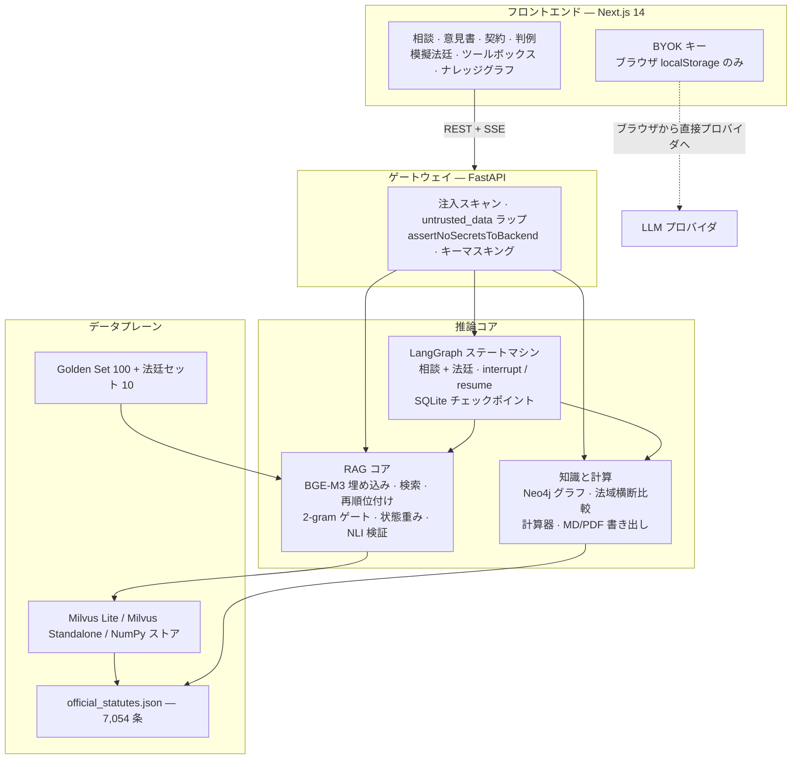

<p align="center">
  
</p>

<h1 align="center">EXCLUSLAWYER</h1>

<p align="center"><strong>オープンソースのマルチ法域リーガル推論ワークベンチ——すべての結論を、現行法条の原文に結びつけます。</strong></p>

<p align="center">
  <a href="README.md">English</a> · <a href="README.zh-CN.md">简体中文</a> · <a href="README.ja.md">日本語</a> · <a href="README.ko.md">한국어</a>
</p>

<p align="center">
  <a href="#概要">概要</a> ·
  <a href="#機能">機能</a> ·
  <a href="#コア原則">コア原則</a> ·
  <a href="#システム構成">システム構成</a> ·
  <a href="#法域とデータソース">法域</a> ·
  <a href="#クイックスタート">クイックスタート</a> ·
  <a href="#リポジトリ構成">リポジトリ</a> ·
  <a href="#ドキュメント">ドキュメント</a> ·
  <a href="#ステータスとロードマップ">ロードマップ</a> ·
  <a href="#既知の制限">制限</a> ·
  <a href="#セキュリティプライバシーコンプライアンス">セキュリティ</a> ·
  <a href="#貢献する">貢献</a> ·
  <a href="#ライセンス">ライセンス</a>
</p>

<p align="center">
  <a href="#ステータスとロードマップ"></a>
  <a href="#法域とデータソース"></a>
  <a href="#法域とデータソース"></a>
  <a href="docs/regression-report.md"></a>
  <a href="docs/regression-report.md"></a>
  <a href="docs/regression-report.md"></a>
  <a href="LICENSE"></a>
  <a href="LICENSE"></a>
</p>

<p align="center">
  
</p>

---

> **免責事項。** EXCLUSLAWYER は法的情報の調査と推演のためのツールです。その出力は研究・参照目的の法的推演にとどまり、法律上の効力を有さず、法律意見ではなく、実際の訴訟に使用することはできません。本プロジェクトは刑事辯護戦略、訴訟代理人業務など、資格を要するサービスを提供しません。実際の権利と利益に関わる重要な案件については、当該法域の有資格弁護士にご相談ください。

## 概要

EXCLUSLAWYER はチャットラッパーではなく、リーガル推論エンジンです。公的公式ソースから法条本文を取得し、すべての結論を実際に読んだ条文に結びつけ、各論点を相手側の弁護士の視点から何度も検証し、失効した条文の重みを下げ、中国・日本・韓国・シンガポールを同じスキーマで並列比較します。

検索が品質ゲートを通る成果物を返せなかった場合、エンジンは条文を作り出す代わりに**証拠不足**と答えます。この「拒否」こそが本プロジェクトで最も重要な振る舞いです。

本ワークベンチは二つの利用場面を想定しています。私有の端末で調査・学習する用途と、案件資料をサードパーティAPIに送れない組織内で自行構築・運用する用途です。モデルキーは任意です。検索と検証のコアは LLM が一切ない状態でも動作し、回答は「条文抜粋のみ」モードにフォールバックします。

<div align="center">

| | |
| --- | --- |
| **登録法条数** | 7,054（すべて公式ソース由来） |
| **法域** | 中国 · 日本 · 韓国 · シンガポール |
| **バックエンドテスト** | 113 passed · 4 skipped · 0 failed |
| **フロントエンドテスト** | 49 / 49 |
| **ハルシネーション率** | 100 件の Golden Set で 0 % |
| **デプロイ** | Docker Compose、またはソースから実行 |
| **キー** | 任意——BYOK はブラウザ内のみ |

</div>

## 機能

以下はすべて本リポジトリに実装済みであり、テストで検証されています。

**ハルシネーション・ゲート付きの根拠検索。** 公的な法条本文を BGE-M3 で埋め込み、bge-reranker-v2-m3 で再順位付けします。候補が採用されるには、クエリとの文字 2-gram 重複率が 0.08 に達するか、意味類似度が 0.35 に達することが必要です。時効状態はランキングの重み付けに使われます（現行 1.0 · 改正済み 0.85 · 時効不明 0.7 · 廃止済み 0.3）——廃止条文は重みを下げ注記するだけで、静かに削除することはありません。

**相談ステートマシン。** LangGraph のワークフローが事実構造化 → 検索 → 両論視点の検証 → NLI 検証 → 意見書生成を順に実行し、検証に落ちた結論は公開前に中断して人の判断を待ちます。承認または却下が可能で、チェックポイントによりセッションは再開できます。

**模擬法廷。** 7 段階の法廷シミュレーション——事案受付 → 事実確定 → 提訴 → 証拠審理 → 対抗討論 → 最終陳述 → 模擬判決——を SSE でストリーミングし、セッションごとに永続化し、引用履歴をすべて含んだ Markdown / PDF として書き出せます。

**平易な言葉レイヤー。** スイッチ（既定でオン）により、回答の平易な説明を緻密な分析より前に表示します。組み込みの 26 の法律用語はクリックで解説 日常の比喩が付きます。文言はバックエンドが実際に返した引用だけから組み立てられ、取得されていない法的根拠を新たに持ち込むことはありません。

**シナリオ入口。** 8 つの生活場面（賃貸敷金、労働、消費、交通、家族、相続、契約、近隣トラブル）から短い質問票に進み、質問票の構造化サマリーが相談欄をプレフィルします（編集は可能です）。

**法域横断比較とナレッジグラフ。** 同一テーマを 4 法域にわたって取得でき、`ANALOGOUS_TO` エッジが対応する規則を結びます。Neo4j があれば Neo4j を、なければ 55 ノード / 64 エッジのスナップショットへフォールバックするため、回答経路は切れません。

**周辺ツール。** 5 段落構成の意見書、契約テキストスキャナ（PDF と貼り付けテキスト）、判例検索、OCR / マルチモーダル経路、法定経済補償・二倍賃料・人身損害賠償の計算器、そしてユーザー評価を Golden Set へ戻すフィードバック経路。

**UI の細部。** ライト／ダークテーマ、ガラスモーフィズムとニューモーフィズムの面（CSS カスタムプロパティで駆動）、スケルトンローディング、キーボード到達可能なコントロール、`prefers-reduced-motion` 対応。アイコンはすべてインライン SVG で、絵文字もアイコンフォントも実行時の外部アセットもありません。

## 検証とベンチマーク

| 指標 | 結果 | しきい値 |
| --- | --- | --- |
| Golden Set メインセット（100件） | 行動ゲート **100 / 100** 通過 | すべて通過 |
| ハルシネーション率 | **0 %** | ≤ 3 % |
| 法条引用の再現率 | **100 %** | ≥ 98 % |
| 結論と根拠の一致（NLI） | **100 %** | ≥ 90 % |
| 時効判定の正確率 | **100 %** | ≥ 99 % |
| 法廷 Golden Set（10例） | 行動ゲート全通過、4指標すべてしきい値内 | — |
| バックエンドテスト（pytest） | **113 passed · 4 skipped · 0 failed** | 0 failed |
| フロントエンドテスト（vitest） | 6ファイルで **49 / 49** | すべて green |
| 本番ビルド（`next build`） | **exit 0 · 0 警告**——`/` 22.9 kB、First Load 131 kB | — |
| Lighthouse、シナリオページ（`/`） | perf **0.99** · a11y **1.00** · LCP **2.0 s** · CLS **0** · TBT 90 ms | LCP < 2.5 s、CLS < 0.1 |
| Lighthouse、模擬法廷（`/mock-trial`） | perf **1.00** · a11y **1.00** · LCP **1.9 s** · CLS **0** · TBT 50 ms | LCP < 2.5 s、CLS < 0.1 |
| 操作レイテンシ（INP） | **N/A**——ヘッドレス監査では操作サンプルが出ない、再測定待ち | < 200 ms、未検証 |

スキップされたバックエンド4ケースは Neo4j の実データベース検証です。稼働中の Docker インスタンスが必要で、同じ経路をカバーするスナップショットバックエンドは毎回テストで実行されます。INP は推測値ではなく N/A とします。ヘッドレスの Lighthouse 実行はポインタやキーボード操作を記録しないためです。

方法論、しきい値、マトリクスの全体は [docs/eval.md](docs/eval.md) · [docs/regression-report.md](docs/regression-report.md) を参照してください。

## コア原則

4 つのルールはパイプライン全体に及びます。スタイル上の好みではなく、コードに書き込まれテストで担保されている硬い制約です。

1. **結論は現行法条の原文に必ず紐づく。** 法条原文に裏づけられない結論は出力しません。検索が品質ゲートを通る成果物を返せなければ、答えは*証拠不足*です。
2. **両論視点の対抗。** すべての論点を相手側弁護士の視点から検討します。事実の穴は積極的に探り、法的リスクは標的検索が実際に裏づけを返した場合にのみ提起します。
3. **時効を造型。** すべての条文は状態、発効日、改正の履歴とともに保存されます。置き換えられた条文は重みを下げて記録として残し、こっそり削除することはありません。
4. **法域間の比較可能性。** 中国・日本・韓国は大陸法系で共通スキーマを共有し、シンガポールはコモンローとして独立した判例層を持ちます。法域間の差はアーキテクチャではなくデータの問題です。

## システム構成



### 技術スタック

| レイヤ | 技術 | 備考 |
| --- | --- | --- |
| フロントエンド | Next.js 14.2.5 · React 18.3 · TypeScript 5.5 · Tailwind CSS 3.4 | App Router、両ルートとも静的出力 |
| グラフ・アイコン | AntV G6 5.1 · lucide-react 0.408 | ナレッジグラフのキャンバス。インライン SVG、絵文字なし |
| API | FastAPI ≥ 0.110 · Pydantic ≥ 2.6 · pydantic-settings ≥ 2.2 · uvicorn ≥ 0.29 | REST と SSE ストリーミング |
| オーケストレーション | LangGraph ≥ 0.2 · langgraph-checkpoint-sqlite ≥ 2.0 | 2 つのステートマシン、interrupt / resume 対応 |
| 検索 | FlagEmbedding（BGE-M3、bge-reranker-v2-m3）· pymilvus ≥ 2.4 · NumPy フォールバック | モデルホスト到達不能時は再順位付けをベクトル類似度へ自動的にベクトル類似度へフォールバック |
| 文書 | pypdf ≥ 4.0 · reportlab ≥ 4.0 | 契約スキャン、法条 PDF の改行・汚染除去、法廷記録の書き出し |
| インフラ | Docker Compose · Redis 7 · Milvus 2.4.4（etcd + MinIO）· Neo4j 5.20 · Celery worker | minimal / full の 2 プロファイル |
| テスト | pytest ≥ 8.0 · vitest 2.1 · Lighthouse 12.8 · Playwright（Chromium） | バックエンド 117 ケース、フロントエンド 49 ケース、アクセシビリティと性能のゲート |
| ランタイム | Python ≥ 3.11（実測 3.13.12）· Node ≥ 18（実測 22.22） | フロントエンドのツールチェーンは Node 22 を推奨 |

## 法域とデータソース

**7,054 条をすべて公的公式ポータルから取り込みました。** 商用データベースは一切使用せず、対応もしていません——Westlaw、LexisNexis、北大法宝、威科先行は意図的にスコープ外であり、データパイプラインにも該当アダプターは存在しません。

| 法域 | 条数 | 公式ソース | 備考 |
| --- | --- | --- | --- |
| 中国 | 2,338 | [flk.npc.gov.cn](https://flk.npc.gov.cn) | 国家法律および行政法規。`sxx` フラグが廃止／旧版／現行を区別 |
| 日本 | 2,610 | [laws.e-gov.go.jp](https://laws.e-gov.go.jp) | e-Gov 法令検索。附則（`附則`）134 条を含む |
| 韓国 | 1,856 | [law.go.kr](https://law.go.kr) | 韓国法令情報センター。憲法は正式名称で登録 |
| シンガポール | 250 | [sso.agc.gov.sg](https://sso.agc.gov.sg) | Singapore Statutes Online：Contracts 107、CRTPA 9、Electronic Transactions 71、Sale of Goods 63 |

中国・日本・韓国は大陸法系で共通スキーマを共有するため、「訴訟時効」のような概念を3法域まとめて検索できます。シンガポールはコモンローで、条文ではなく判例に紐づく独立した判例層を持ちます。

すべての条文は法域、言語、状態、発効日、改正履歴を保持します。再取り込みは冪等です。upsert は条文 id をキーとします。

## クイックスタート

```bash
git clone https://github.com/zyh798-cell/excluslawyer.git
cd excluslawyer
```

### Docker

```bash
# minimal 構成 — API + Web + Redis（ベクトルストアはローカルファイル）
docker compose up --build

# full 構成 — Milvus Standalone、Neo4j、Celery ワーカーを追加
docker compose --profile full up --build
```

- Web インターフェース — <http://localhost:3000>
- API ドキュメント — <http://localhost:8000/docs>

### ソースから実行

```bash
cd backend
python -m venv .venv
source .venv/bin/activate          # Windows: .venv\Scripts\activate
pip install -r requirements.txt     # コア実行時依存（torch 不要）
pip install -r requirements-ml.txt  # 任意：BGE-M3 埋め込みと再順位付け
python scripts/ingest_cn.py         # ベクトルストアへのシード投入
uvicorn app.main:app --reload --port 8000

cd ../frontend
npm install
npm run dev
```

`requirements-ml.txt` を入れなくてもエンジン全体は動きます。埋め込みはハッシュベクトルへ退避し、言語モデルは「条文抜粋のみ」のデモモードに入ります。劣化はしますが、捏造はしません。

同梱のシードではなく公式ポータルから条文群を更新する場合:

```bash
cd backend
python scripts/fetch_statutes.py --jur --ingest      # 空の --jur はオンライン化せず統合・登録のみ
python scripts/build_kg.py                            # ナレッジグラフのスナップショットを再構築
```

### BYOK —— 自分で用意するキー

モデルアクセスは任意で、キーがサーバーに届くことはありません。

1. Web インターフェースを開き、ヘッダーの **BYOK 设置** を展開します。
2. OpenAI 互換のエンドポイント、API キー、モデル名を入力します。
3. キーはブラウザの `localStorage`（`lexsentinel.byok`）に書き込まれ、そこに留まります。

ブラウザは選択したモデルプロバイダへ直接接続します。バックエンドが露出するのはステートレスな検索（`/api/retrieve`）と検証（`/api/verify`）のみで、サーバーへ送るすべての载荷は秘密情報を含まぬことを表明し、サーバーは設計上キーを保持しません。キーがない場合、回答は抜粋モード——条文本文のみ、自由な文章生成なし——に退避します。

サーバー側デモモードを使う場合は `.env.example` を `.env` にコピーし、`LLM_BASE_URL`、`LLM_API_KEY`、`LLM_MODEL` を設定します。BYOK 運用では空のままにしてください。

## リポジトリ構成

```text
lex-sentinel/
├── backend/
│   ├── app/
│   │   ├── api/             # REST と SSE のルート
│   │   ├── core/            # LLM クライアント · プロンプト · セキュリティガード
│   │   ├── data_pipeline/   # 公式ソース取得器と正規化
│   │   ├── eval/            # Golden Set ランナー
│   │   ├── graph/           # LangGraph 相談／法廷ステートマシン
│   │   ├── kg/              # スキーマ · ビルダ · Neo4j バックエンド · スナップショット
│   │   ├── rag/             # エンベッダ · リトリーバ · ベクトルストア
│   │   ├── services/        # ask · opinion · trial · compare · 書き出し
│   │   └── main.py
│   ├── data/                # 条文 · Golden Set · グラフスナップショット（一部 git 除外）
│   ├── scripts/             # fetch_statutes · ingest_cn · build_kg · golden_regression
│   └── tests/               # 117 ケース収集 — 113 passed · 4 skipped
├── frontend/
│   ├── src/app/             # ルート：/ と /mock-trial
│   ├── src/components/      # UI コンポーネント
│   ├── src/config/          # シナリオ定義
│   ├── src/lib/             # API クライアント · テーマ · 平易な言葉エンジン · 用語集
│   └── src/test/            # vitest スイート — 49 ケース
├── assets/                  # ブランドベクター原版（logo.svg）
├── tools/                  # ブランド資産ビルダーと README 整合性チェッカー
├── docs/                    # ドキュメント一式とブランド素材
├── docker-compose.yml
├── .env.example
└── LICENSE
```

## ドキュメント

| ドキュメント | 内容 |
| --- | --- |
| [docs/architecture.md](docs/architecture.md) | デュアルバックエンド検索、BGE-M3 パイプライン、ナレッジグラフ、公式ソース取り込み、SGA 1979 の PDF デコンタミナション |
| [docs/scenario-entry.md](docs/scenario-entry.md) | シナリオ入口レイヤー：8 つの生活シナリオ、段階式質問票、構造化サマリーのプレフィル、アクセシビリティ整改の記録 |
| [docs/plain-explain.md](docs/plain-explain.md) | 平易な言葉レイヤー：モードスイッチ、生成規則、セクション配置、26 語の用語解説 |
| [docs/mock-court.md](docs/mock-court.md) | 模擬法廷ステートマシン、7 つの法廷段階、証拠と時効の仕組み、MD と PDF の書き出し |
| [docs/mock-trial.md](docs/mock-trial.md) | 実装メモ：チェックポイントのシリアライズ、SSE のフレーミング、書き出しスキーマ |
| [docs/eval.md](docs/eval.md) | Golden Set の方法論、ハルシネーション検証、回帰マトリクス |
| [docs/regression-report.md](docs/regression-report.md) | 本反復の回帰レポート：テスト件数、ビルド出力、Lighthouse 結果、手動確認マトリクス |
| [docs/known-issues.md](docs/known-issues.md) | 既知の問題一覧：症状、根本原因、影響、修正計画、項目ごとの状況 |

ブランド素材はドキュメントと同じ場所に置かれます：`docs/banner.svg`（アニメーションするバナー）、`docs/logo.svg`（120 × 120 のアニメーション標章）、`docs/favicon.svg`（16 / 24 / 32 px 用のモノクロシルエット）、`assets/logo.svg`（静的ベクター原版）。いずれも自己完結型の SVG で、動きはインライン CSS によるもので外部依存はありません。`prefers-reduced-motion: reduce` の環境ではアニメーションが停止します。

## ステータスとロードマップ

**v0.1.0 はプレリリースです。** エンジン、模擬法廷、平易な言葉レイヤー、データパイプラインは動作し、テストを通っています。UI は現在中国語（簡体字）のみです。

### 進行中

- 質問票の構造化スキーマとサーバサイド検証（現在はブラウザ側のみで検証）
- 手続きガイダンス——「次は何をするか」の行動リスト。公式の申立窓口や訴訟時効と連動させます
- 多言語 UI——ドキュメントは4言語用意済みですが、プロダクトの UI にはまだありません
- 平易な言葉の個別生成——バックエンドが `plain_answer` フィールドを返した場合、決定論的テンプレートよりそちらを優先します
- 証拠アシスタント、文書テンプレート生成、越境ファシクパック
- 中国語 26 語を超える多言語用例集

### 計画中

- 公開評価ダッシュボード
- 匿名化済みデモ案例集
- ブラウザ拡張機能
- モバイル PWA
- 新しい法域の追加

## 既知の制限

- **一貫性チェックは語彙的であって意味的ではありません。** NLI 段階は「結論が根拠と一致するか」を文字と語の集合の重なりで近似します。方針は保守的で、合わなければ放行せず降格させます。ただし表現が正しくても語彙が違う結論は低く評価されることがあります。
- **操作応答性は未計測です。** Lighthouse はヘッドレス実行で操作トレースを生成しないため、INP は推測値ではなく N/A と記載しています。両ルートとも LCP と CLS は予算内です。
- **グラフのテストには Docker が必要です。** 接続可能な Neo4j がない場合 4 ケースがスキップされます。代替のスナップショットバックエンドにはカバレッジがあります。
- **2 つの法廷 API が併存しています。** 旧来のラウンド制エンドポイントは互換性のために残しており、削除予定として示されています。UI はすでにステートマシンを使用しています。
- **シンガポール ポータルは頻度女演员に敏感です。** WAF が自動リクエストを断続的に拒否するため、パイプラインは再試行を連打せず、クールダウンを待って差分補完します。
- **法域横断のシード項目は要確認です。** 一部のテーマ別比較行は概要シードであり、公式確認が必要と注記されています。
- **平易な言葉レイヤーはテンプレート式です。** 翻訳と解説を行うのみで言語モデルを呼びません。したがって渡された引用以上に具体的なことは言えません。
- **UI の言語は中国語（簡体字）のみです。** ドキュメントは多言語ですが、プロダクトはまだです。

## セキュリティ、プライバシー、コンプライアンス

- **案件データはローカルに留まります。** 文書や案件資料はエンジンを動かす端末で解析されます。自分で設定しない限り、第三者のサービスへ送信されることも、モデルの学習に使われることもありません。
- **文書は明示的に保存しない限り永続化しません。** 解析されたテキストは現在のセッション内だけに保持され、保存には明示的な操作が必要です。
- **プロンプト注入は物理的に隔離されます。** 取得された文書とユーザー入力はいずれも untrusted data として包み、システムプロンプトとは別領域に置かれます。ジェイルブレイクテンプレートは検知され拒答されます。
- **キーがサーバーに届くことはありません。** BYOK キーはブラウザの `localStorage` に置かれ、ブラウザがプロバイダへ直接接続します。サーバーへ送る载荷は秘密情報を含まぬことが表明され、エラー出力はマスキングされます。
- **公的公式ソースのみ。** 条文本文は公開法情報ポータル由来で、裁判所文書は取り込み前にプライバシー加工されます。商用データベースは一切接続しません。
- **設計上、拒否します。** 刑事辯護戦略、訴訟代理人業務など資格を要する成果物は拒否し、有資格弁護士へ誘導します。
- **本リポジトリが提供するのはコードだけです。** 公開インスタンスを運用する各方は、法・プライバシー・セキュリティ上の責任を自行して負います。プロジェクトは保証を提供せず、ホスティングも行いません。

## 貢献する

Issue と Pull Request を歓迎します。特に、引用を厳密化する場合、検索が失敗しているケースを改善する場合、他の法域へカバレッジを広げる場合の貢献が уніjetaされます。

- 提出前にバックエンドのテストを通してください：`cd backend && python -m pytest tests/ -q`
- フロントエンドのテストを通してください：`cd frontend && npm test`
- 4 つのコア原則を保ってください。根拠づけ、両論視点、時効、法域比較を弱める変更は取り込まれません。
- 新しい法域の追加は公的公式ソースを用い、取り込み方法、品質ゲート、テストを文書化してください。
- 既存のコードスタイルに合わせ、ユーザー向け文言に絵文字を使わないでください。アイコンはインライン SVG です。

## ライセンス

- **コード** — [AGPL-3.0](LICENSE)。エンジンソースは GNU Affero General Public License v3 でライセンスされています。
- **データセット** — 条文本文とナレッジグラフのスナップショットは [CC BY-NC 4.0](https://creativecommons.org/licenses/by-nc/4.0/) で公開しています。条文の文言は公的公式法情報データベース（flk.npc.gov.cn、laws.e-gov.go.jp、law.go.kr、sso.agc.gov.sg）由来であり、構造化・整形・グラフ構築は原作で、クレジットを付せば非商用に再利用できます。

---

<p align="center"><em>Intelligence · Precision · Open by design</em></p>
