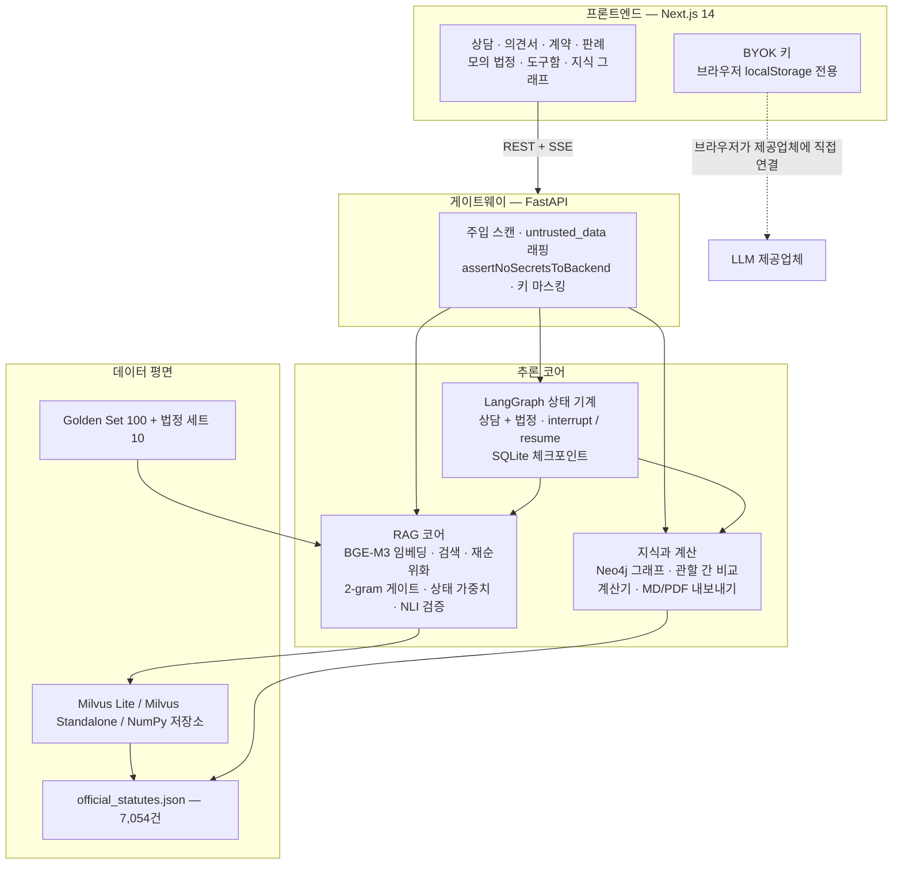

<p align="center">
  
</p>

<h1 align="center">EXCLUSLAWYER</h1>

<p align="center"><strong>오픈소스 다법역 법률 추론 워크벤치 — 모든 결론을 현행 법조문 원문에 연결합니다.</strong></p>

<p align="center">
  <a href="README.md">English</a> · <a href="README.zh-CN.md">简体中文</a> · <a href="README.ja.md">日本語</a> · <a href="README.ko.md">한국어</a>
</p>

<p align="center">
  <a href="#개요">개요</a> ·
  <a href="#기능">기능</a> ·
  <a href="#핵심-원칙">핵심 원칙</a> ·
  <a href="#아키텍처">아키텍처</a> ·
  <a href="#관할과-데이터-소스">관할</a> ·
  <a href="#빠른-시작">빠른 시작</a> ·
  <a href="#저장소-구조">저장소</a> ·
  <a href="#문서">문서</a> ·
  <a href="#상태-및-로드맵">로드맵</a> ·
  <a href="#알려진-제약">제약</a> ·
  <a href="#보안-개인정보-및-컴플라이언스">보안</a> ·
  <a href="#기여하기">기여</a> ·
  <a href="#라이선스">라이선스</a>
</p>

<p align="center">
  <a href="#상태-및-로드맵"></a>
  <a href="#관할과-데이터-소스"></a>
  <a href="#관할과-데이터-소스"></a>
  <a href="docs/regression-report.md"></a>
  <a href="docs/regression-report.md"></a>
  <a href="docs/regression-report.md"></a>
  <a href="LICENSE"></a>
  <a href="LICENSE"></a>
</p>

<p align="center">
  
</p>

---

> **면책 조항.** EXCLUSLAWYER는 법률 정보 조사와 추론을 위한 도구입니다. 그 출력은 연구·참고 목적의 법적 추론에 그칠 뿐 법적 효력이 없으며, 법률 자문이 아니고 실제 소송에 사용할 수 없습니다. 이 프로젝트는 형사 변호 전략, 소송 대리 등执业 자격이 필요한 서비스를 제공하지 않습니다. 실제 권리와 이익에 영향을 미치는 중요한 사안은 해당 관할의 자격을 갖춘 변호사와 상담하십시오.

## 개요

EXCLUSLAYWER는 채팅 래퍼가 아니라 법률 추론 엔진입니다. 공공 공식 출처에서 법조문 본문을 검색하고, 모든 결론을 실제로 읽은 조문에 연결하며, 각 쟁점을 상대 변호 측 관점에서 반복 검증하고, 효력이 사라진 조문의 가중치를 낮추며, 중국·일본·한국·싱가포르를 하나의 스키마로 나란히 비교합니다.

검색이 품질 게이트를 통과한 산출물을 내지 못하면 엔진은 조문을 만들어내는 대신 **근거 부족**으로 답합니다. 이 "거절"이 이 프로젝트에서 가장 중요한 동작입니다.

이 워크벤치는 두 가지 상황을 염두에 두고 설계되었습니다. 사설 기기에서 조사·학습하는 경우, 그리고 사건 자료를 제3자 API로 보낼 수 없는 조직 내부에서 직접 구축·운영하는 경우입니다. 모델 키는 선택 사항이며, 검색과 검증 코어는 LLM 없이도 동작하며 답은 "조문 발췌만" 모드로 낮아집니다.

<div align="center">

| | |
| --- | --- |
| **입고 조문** | 7,054건, 모두 공식 출처 기준 |
| **관할** | 중국 · 일본 · 한국 · 싱가포르 |
| **백엔드 테스트** | 113 passed · 4 skipped · 0 failed |
| **프론트엔드 테스트** | 49 / 49 |
| **환각률** | 100건 Golden Set 기준 0 % |
| **배포** | Docker Compose 또는 소스 실행 |
| **키** | 선택 사항 — BYOK는 브라우저에만 존재 |

</div>

## 기능

아래 항목은 모두 이 저장소에 구현되어 있으며 테스트로 검증됩니다.

**환각 게이트를 갖춘 근거 기반 검색.** 공식 법조문을 BGE-M3로 임베딩하고 bge-reranker-v2-m3으로 재순위화합니다. 후보가 검색 결과에 포함되려면 질의와의 문자 2-gram 중복률이 0.08 이상이거나 의미 유사도가 0.35 이상이어야 합니다. 시효 상태가 순위에 가중치로 반영됩니다(현행 1.0 · 개정 0.85 · 시효 불명 0.7 · 폐지 0.3) — 폐지 조문은 가중치를 낮추고 표기할 뿐, 조용히 삭제하지 않습니다.

**상담 상태 기계.** LangGraph 워크플로가 사실 구조화 → 검색 → 쌍면 검증 → NLI 검증 → 의견서 작성 순으로 동작하며, 검증에 실패한 결론은 공개 전에 중단되어 사람의 판단을 기다립니다. 승인 또는 기각이 가능하고, 체크포인트 저장소 덕분에 세션이 재개됩니다.

**모의 법정.** 7단계 법정 시뮬레이션 — 사실 접수 → 사실 확정 → 소가 접수 → 증거 심리 → 대항 논쟁 → 최종 진술 → 모의 판결 — 을 SSE로 스트리밍하고, 세션별로 보존하며, 완전한 인용 경로를 담은 Markdown 또는 PDF로 내보냅니다.

**평易于 말하는 설명 레이어.** 스위치(기본 켜짐)가 답변의 평이한 설명을 전문 분석보다 앞에 배치하며, 내장된 26개 법률 용어를 클릭하면 everyday 비유가 붙은 설명이 열립니다. 문구는 백엔드가 실제로 반환한 인용만으로 구성되며, 검색되지 않은 법적 근거를 새로 끌어들이지 않습니다.

**시나리오 진입.** 8가지 생활 상황(임대 보증금, 근로, 소비자, 교통, 가족, 상속, 계약, 이웃 문제)에서 짧은 설문으로 이어지고, 설문의 구조화된 요약이 상담 입력창을 미리 채웁니다(수정 가능).

**관할 간 비교와 지식 그래프.** 같은 주제를 4개 관할에 걸쳐 조회할 수 있고, `ANALOGOUS_TO` 간선이 대응 규칙을 연결합니다. Neo4j가 있으면 Neo4j를, 없으면 55노드 / 64엣지 스냅샷으로 대체하므로 답변 경로가 끊기지 않습니다.

**보조 도구.** 5단 구성 의견서, 계약 텍스트 스캐너(PDF와 붙여넣기 텍스트), 판례 검색, OCR / 멀티모달 경로, 법정 경제보상·이중임금·인신손해배상 계산기, 그리고 사용자 피드백을 Golden Set으로 되돌리는 경로.

**UI 세부 사항.** 라이트/다크 테마, 글래스모피즘과 뉴모피즘 표면(CSS 커스텀 프로퍼티로 구동), 스켈레톤 로딩, 키보드로 접근 가능한 컨트롤, `prefers-reduced-motion` 지원. 아이콘은 모두 인라인 SVG이며 이모지·아이콘 폰트·런타임 외부 자원 없이 동작합니다.

## 검증 및 벤치마크

| 지표 | 결과 | 기준 |
| --- | --- | --- |
| Golden Set 메인 세트(100건) | 행동 게이트 **100 / 100** 통과 | 전부 통과 |
| 환각률 | **0 %** | ≤ 3 % |
| 법조문 인용 회수율 | **100 %** | ≥ 98 % |
| 결론과 근거의 일치(NLI) | **100 %** | ≥ 90 % |
| 시효 판정 정확도 | **100 %** | ≥ 99 % |
| 법정 Golden Set(10건) | 행동 게이트 전부 통과, 4개 지표 모두 기준 이내 | — |
| 백엔드 테스트(pytest) | **113 passed · 4 skipped · 0 failed** | 0 failed |
| 프론트엔드 테스트(vitest) | 7개 파일에 걸쳐 **56 / 56** | 전부 통과 |
| 프로덕션 빌드(`next build`) | **exit 0 · 0 경고** — `/` 22.9 kB, First Load 132 kB | — |
| Lighthouse, 시나리오 페이지(`/`) | perf **0.99** · a11y **1.00** · LCP **2.0 s** · CLS **0** · TBT 90 ms | LCP < 2.5 s, CLS < 0.1 |
| Lighthouse, 모의 법정(`/mock-trial`) | perf **1.00** · a11y **1.00** · LCP **1.9 s** · CLS **0** · TBT 50 ms | LCP < 2.5 s, CLS < 0.1 |
| 조작 지연 시간(INP) | **N/A** — 헤드리스 감사에는 조작 샘플이 없어 재측정 예정 | < 200 ms, 미검증 |

건너뛴 백엔드 4건은 Neo4j 실제 데이터베이스 검증입니다. 실행 중인 Docker 인스턴스가 필요하며, 같은 경로를 다루는 스냅샷 백엔드는 매 테스트 실행마다 검증됩니다. INP는 추정치가 아니라 N/A로 표기합니다. 헤드리스 Lighthouse 실행은 포인터나 키보드 조작을 기록하지 않기 때문입니다.

방법론, 기준, 전체 매트릭스는 [docs/eval.md](docs/eval.md) · [docs/regression-report.md](docs/regression-report.md)를 참고하십시오.

## 핵심 원칙

네 가지 규칙은 파이프라인 전체에 걸쳐 적용됩니다. 취향이 아니라 코드에 구현되고 테스트로 보장되는 확고한 제약입니다.

1. **결론은 반드시 현행 법조문 원문에 묶입니다.** 법조문 원문으로 뒷받침되지 않은 결론은 출력하지 않습니다. 검색이 품질 게이트를 통과한 산출물을 내지 못하면 답은 *근거 부족*입니다.
2. **쌍면 대립.** 모든 쟁점은 상대 변호 측 관점에서 검토됩니다. 사실의 빈틈은 적극적으로 찾아내고, 법적 위험은 표적 검색이 실제로 뒷받침을 반환한 경우에만 제기합니다.
3. **시효 인식.** 모든 조문은 상태, 발효일, 개정 이력과 함께 저장됩니다. 대체된 조문은 가중치를 낮춰 기록으로 남기고, 몰래 삭제하지 않습니다.
4. **관할 간 비교 가능성.** 중국·일본·한국은 대륙법계 공통 스키마를 공유하고, 싱가포르는 영미법계로 별도의 판례 계층을 갖습니다. 관할 간 차이는 아키텍처가 아니라 데이터의 문제입니다.

## 아키텍처



### 기술 스택

| 계층 | 기술 | 비고 |
| --- | --- | --- |
| 프론트엔드 | Next.js 14.2.5 · React 18.3 · TypeScript 5.5 · Tailwind CSS 3.4 | App Router, 두 라우트 모두 정적 출력 |
| 그래프와 아이콘 | AntV G6 5.1 · lucide-react 0.408 | 지식 그래프 캔버스, 인라인 SVG, 이모지 미사용 |
| API | FastAPI ≥ 0.110 · Pydantic ≥ 2.6 · pydantic-settings ≥ 2.2 · uvicorn ≥ 0.29 | REST와 SSE 스트리밍 |
| 오케스트레이션 | LangGraph ≥ 0.2 · langgraph-checkpoint-sqlite ≥ 2.0 | 두 개의 상태 기계, interrupt / resume 지원 |
| 검색 | FlagEmbedding(BGE-M3, bge-reranker-v2-m3) · pymilvus ≥ 2.4 · NumPy 폴백 | 모델 호스트 접근 불가 시 재순위화를 벡터 유사도로 자동으로 벡터 유사도 정렬로 되돌림 |
| 문서 | pypdf ≥ 4.0 · reportlab ≥ 4.0 | 계약 스캔, 법조문 PDF 정제, 법정 기록 내보내기 |
| 인프라 | Docker Compose · Redis 7 · Milvus 2.4.4(etcd + MinIO) · Neo4j 5.20 · Celery worker | minimal / full 두 프로파일 |
| 테스트 | pytest ≥ 8.0 · vitest 2.1 · Lighthouse 12.8 · Playwright(Chromium) | 백엔드 117케이스, 프론트엔드 56케이스, 접근성과 성능 게이트 |
| 런타임 | Python ≥ 3.11(실측 3.13.12) · Node ≥ 18(실측 22.22) | 프론트엔드 툴체인에는 Node 22 권장 |

## 관할과 데이터 소스

**7,054건 모두 공공 공식 포털에서 수집했습니다.** 상용 데이터베이스는 사용하지도 지원하지도 않으며 — Westlaw, LexisNexis, 北大法宝, 威科先行은 의도적으로 범위에서 제외되었고 데이터 파이프라인에도 해당 어댑터가 없습니다.

| 관할 | 건수 | 공식 출처 | 비고 |
| --- | --- | --- | --- |
| 중국 | 2,338 | [flk.npc.gov.cn](https://flk.npc.gov.cn) | 국가 법률 및 행정法规, `sxx` 플래그로 폐지/구판/현행 구분 |
| 일본 | 2,610 | [laws.e-gov.go.jp](https://laws.e-gov.go.jp) | e-Gov 法令検索, 부칙(`附則`) 134건 포함 |
| 한국 | 1,856 | [law.go.kr](https://law.go.kr) | 한국 법령정보센터, 헌법은 정식 명칭으로 저장 |
| 싱가포르 | 250 | [sso.agc.gov.sg](https://sso.agc.gov.sg) | Singapore Statutes Online: Contracts 107, CRTPA 9, Electronic Transactions 71, Sale of Goods 63 |

중국·일본·한국은 대륙법계 공통 스키마를 공유하므로 "소송시효" 같은 개념을 세 관할에 걸쳐 한 번에 조회할 수 있습니다. 싱가포르는 영미법계로 조문이 아니라 판례에 연결되는 별도의 판례 계층을 갖습니다.

모든 조문은 관할, 언어, 상태, 발효일, 개정 이력을 보관합니다. 재수집은 멱등입니다. upsert는 조문 id를 키로 사용합니다.

## 빠른 시작

```bash
git clone https://github.com/zyh798-cell/excluslawyer.git
cd excluslawyer
```

### Docker

```bash
# 최소 구성 — API + Web + Redis(벡터 저장소는 로컬 파일)
docker compose up --build

# 전체 구성 — Milvus Standalone, Neo4j, Celery 워커 추가
docker compose --profile full up --build
```

- 웹 인터페이스 — <http://localhost:3000>
- API 문서 — <http://localhost:8000/docs>

### 소스로 실행

```bash
cd backend
python -m venv .venv
source .venv/bin/activate          # Windows: .venv\Scripts\activate
pip install -r requirements.txt     # 핵심 런타임(torch 불필요)
pip install -r requirements-ml.txt  # 선택: BGE-M3 임베딩과 재순위화
python scripts/ingest_cn.py         # 벡터 저장소에 시드 적재
uvicorn app.main:app --reload --port 8000

cd ../frontend
npm install
npm run dev
```

`requirements-ml.txt`를 설치하지 않아도 엔진은 끝까지 동작합니다. 임베딩은 해시 벡터로 대체되고 언어 모델은 "조문 발췌만" 데모 모드로 들어갑니다. 성능은 떨어지지만 만들어내지는 않습니다.

내장 시드가 아니라 공식 포털에서 조문 모음을 갱신하려면:

```bash
cd backend
python scripts/fetch_statutes.py --jur --ingest      # 빈 --jur 은 네트워크 없이 통합·적재만 수행
python scripts/build_kg.py                            # 지식 그래프 스냅샷 재생성
```

### BYOK — 직접 가져오는 키

모델 접근은 선택 사항이며 키는 서버에 도달하지 않습니다.

1. 웹 인터페이스를 열고 헤더의 **BYOK 设置** 을 펼치십시오.
2. OpenAI 호환 엔드포인트, API 키, 모델 이름을 입력합니다.
3. 키는 브라우저의 `localStorage`(`excluslawyer.byok`)에 기록되고 그 자리에 남습니다.

브라우저가 선택한 모델 제공업체에 직접 연결합니다. 백엔드는 상태 없는 검색(`/api/retrieve`)과 검증(`/api/verify`)만 노출하며 서버로 보내는 모든 페이로드는 비밀정보가 없음을 단언하고, 서버는 설계상 키를 보유하지 않습니다. 키가 없으면 답은 발췌 모드 — 조문 본문만, 자유로운 문장 생성 없음 — 로 낮아집니다.

서버 측 데모 모드를 쓰려면 `.env.example`을 `.env`로 복사하고 `LLM_BASE_URL`, `LLM_API_KEY`, `LLM_MODEL`을 설정하십시오. BYOK 배포에서는 비워 두십시오.

## 저장소 구조

```text
excluslawyer/
├── backend/
│   ├── app/
│   │   ├── api/             # REST와 SSE 라우트
│   │   ├── core/            # LLM 클라이언트 · 프롬프트 · 보안 가드
│   │   ├── data_pipeline/   # 공식 출처 수집기와 정규화
│   │   ├── eval/            # Golden Set 러너
│   │   ├── graph/           # LangGraph 상담·법정 상태 기계
│   │   ├── kg/              # 스키마 · 빌더 · Neo4j 백엔드 · 스냅샷
│   │   ├── rag/             # 임베더 · 리트리버 · 벡터 저장소
│   │   ├── services/        # ask · opinion · trial · compare · 내보내기
│   │   └── main.py
│   ├── data/                # 조문 · Golden Set · 그래프 스냅샷(일부 git 제외)
│   ├── scripts/             # fetch_statutes · ingest_cn · build_kg · golden_regression
│   └── tests/               # 117케이스 수집 — 113 passed · 4 skipped
├── frontend/
│   ├── src/app/             # 라우트: / 와 /mock-trial
│   ├── src/components/      # UI 컴포넌트
│   ├── src/config/          # 시나리오 정의
│   ├── src/lib/             # API 클라이언트 · 테마 · 평이한 설명 엔진 · 용어집
│   └── src/test/            # vitest 스위트 — 56케이스
├── assets/                  # 브랜드 벡터 원본(logo.svg)
├── tools/                  # 브랜드 자산 빌더와 README 일관성 검사기
├── docs/                    # 문서 모음과 브랜드 자원
├── docker-compose.yml
├── .env.example
└── LICENSE
```

## 문서

| 문서 | 내용 |
| --- | --- |
| [docs/architecture.md](docs/architecture.md) | 듀얼 백엔드 검색, BGE-M3 파이프라인, 지식 그래프, 공식 출처 수집, SGA 1979 PDF 정제 |
| [docs/scenario-entry.md](docs/scenario-entry.md) | 시나리오 진입 레이어: 8개 생활 시나리오, 단계별 설문, 구조화 요약 프리필, 접근성 개선 기록 |
| [docs/plain-explain.md](docs/plain-explain.md) | 평이한 설명 레이어: 모드 스위치, 생성 규칙, 섹션 배치, 26개 용어 해설 |
| [docs/mock-court.md](docs/mock-court.md) | 모의 법정 상태 기계, 7개 법정 단계, 증거·시효 메커니즘, MD와 PDF 내보내기 |
| [docs/mock-trial.md](docs/mock-trial.md) | 구현 메모: 체크포인트 직렬화, SSE 프레이밍, 내보내기 스키마 |
| [docs/eval.md](docs/eval.md) | Golden Set 방법론, 환각률 검증, 회귀 매트릭스 |
| [docs/regression-report.md](docs/regression-report.md) | 이번 반복의 회귀 보고서: 테스트 수, 빌드 산출물, Lighthouse 결과, 수동 확인 매트릭스 |
| [docs/known-issues.md](docs/known-issues.md) | 알려진 문제 목록: 증상, 원인, 영향, 수정 계획, 항목별 상태 |

브랜드 자원은 문서와 같은 위치에 있습니다: `docs/banner.svg`(애니메이션 배너), `docs/logo.svg`(120 × 120 애니메이션 마크), `docs/favicon.svg`(16 / 24 / 32 px 모노크롬 실루엣), `assets/logo.svg`(정적 벡터 원본). 각 파일은 자체 완결형 SVG이며 움직임은 인라인 CSS로 구현되어 외부 의존성이 없습니다. `prefers-reduced-motion: reduce` 환경에서는 애니메이션이 멈춥니다.

## 상태 및 로드맵

**v0.1.0은 프리릴리스입니다.** 엔진, 모의 법정, 평이한 설명 레이어, 데이터 파이프라인은 동작하고 테스트를 통과했습니다. 인터페이스는 현재 간체 중국어로만 제공됩니다.

### 진행 중

- 설문 구조화 스키마와 서버 측 검증(현재 브라우저 측 검증만 수행)
- 절차 안내 — "다음에 무엇을 해야 하는가" 행동 목록. 공식 접수 창구와 소송시효에 연동
- 다국어 인터페이스 — 문서는 4개 언어로 준비됐지만 제품 인터페이스는 아직 없음
- 개인화된 평이한 설명 생성 — 백엔드가 `plain_answer` 필드를 반환하면 결정론적 템플릿보다 그 값을 우선 사용
- 증거 도우미, 문서 템플릿 생성, 국경 간 주제 패키지
- 중국어 26개 용어를 넘어서는 다국어 용어집

### 계획

- 공개 평가 대시보드
- 비식별 데모 사례 라이브러리
- 브라우저 확장 프로그램
- 모바일 PWA
- 새로운 관할 추가

## 알려진 제약

- **일관성 검사는 어휘적이지 의미적이 아닙니다.** NLI 단계는 "결론이 근거와 일치하는가"를 문자와 어휘 집합의 겹침으로 근사합니다. 방향은 보수적이어서 맞지 않으면 통과시키지 않고 하향 표기합니다. 다만 표현이 옳아도 어휘가 다른 결론은 낮게 평가될 수 있습니다.
- **조작 지연 시간은 측정되지 않았습니다.** Lighthouse는 헤드리스로 실행되어 조작 트레이스를 만들지 않으므로 INP는 추정치가 아니라 N/A로 표기합니다. 두 라우트 모두 LCP와 CLS는 예산 이내입니다.
- **그래프 테스트에는 Docker가 필요합니다.** 연결 가능한 Neo4j가 없으면 4개 케이스가 건너뜁니다. 대체 스냅샷 백엔드는 커버리지가 있습니다.
- **두 가지 법정 API가 공존합니다.** 예전 라운드 기반 엔드포인트는 호환성을 위해 남아 있고 제거 예정으로 표시되어 있습니다. 인터페이스는 이미 상태 기계를 사용합니다.
- **싱가포르 포털은 요청 빈도에 민감합니다.** WAF가 자동 요청을 간헐적으로 거부하므로 파이프라인은 무작정 재시도하지 않고 쿨다운을 기다린 뒤 증분 보완합니다.
- **관할 간 시드 항목은 확인이 필요합니다.** 일부 주제 단위 비교 항목은 요약 시드이며 공식 확인이 필요하다는 표시가 되어 있습니다.
- **평이한 설명 레이어는 템플릿 방식입니다.** 번역과 설명만 하며 언어 모델을 호출하지 않습니다. 따라서 받은 인용보다 더 구체적인 내용은 말하지 않습니다.
- **인터페이스 언어는 간체 중국어뿐입니다.** 문서는 다국어지만 제품은 아직 아닙니다.

## 보안, 개인정보 및 컴플라이언스

- **사건 데이터는 로컬에 남습니다.** 문서와 사건 자료는 엔진을 실행하는 컴퓨터에서 파싱됩니다. 직접 설정하지 않는 한 제3자 서비스로 전송되지 않고 모델 학습에도 쓰이지 않습니다.
- **문서는 요청하지 않으면 저장되지 않습니다.** 파싱된 텍스트는 현재 세션 동안만 유지되며, 저장하려면 명시적 조치가 필요합니다.
- **프롬프트 주입은 물리적으로 격리됩니다.** 검색된 문서와 사용자 입력은 모두 untrusted data로 감싸져 시스템 프롬프트와 분리된 영역에 놓입니다. 재어택 템플릿은 탐지되어 거절됩니다.
- **키는 서버에 도달하지 않습니다.** BYOK 키는 브라우저의 `localStorage`에 있고 브라우저가 제공업체에 직접 연결하며, 서버로 보내는 페이로드에는 비밀정보가 없음을 단언하고 오류 출력은 마스킹됩니다.
- **공공 공식 출처만 사용합니다.** 조문 본문은 공개 법령 포털에서 오며, 법원 문서는 적재 전에 개인정보 가공을 거칩니다. 상용 데이터베이스는 연결하지 않습니다.
- **설계상 거절합니다.** 형사 변호 전략, 소송 대리 등 자격이 필요한 산출물은 거절하고 자격을 갖춘 변호사로 안내합니다.
- **이 저장소는 코드만 제공합니다.** 공개 인스턴스를 운영하는 쪽이 법적·개인정보·보안 책임을 직접 집니다. 프로젝트는 어떠한 보증도 제공하지 않으며 호스팅도 하지 않습니다.

## 기여하기

Issue와 Pull Request를 환영합니다. 특히 인용을 더 단단히 하거나, 실패하는 검색 사례를 고치거나, 다른 관할로 커버리지를 넓히는 기여가 큰 도움이 됩니다.

- 제출 전 백엔드 테스트를 돌리십시오: `cd backend && python -m pytest tests/ -q`
- 프론트엔드 테스트를 돌리십시오: `cd frontend && npm test`
- 네 가지 핵심 원칙을 유지하십시오. 근거, 대립, 시효, 관할 비교를 약화시키는 변경은 병합되지 않습니다.
- 새 관할 추가는 공공 공식 출처를 사용하고 수집 방법, 품질 게이트, 테스트를 문서화해야 합니다.
- 기존 코드 스타일을 따르고 사용자 대상 문구에 이모지를 쓰지 마십시오. 아이콘은 인라인 SVG입니다.

## 라이선스

- **코드** — [AGPL-3.0](LICENSE). 엔진 소스는 GNU Affero General Public License v3으로 라이선스됩니다.
- **데이터셋** — 조문 본문과 지식 그래프 스냅샷은 [CC BY-NC 4.0](https://creativecommons.org/licenses/by-nc/4.0/)으로 공개합니다. 조문 문구는 공공 공식 법령 데이터베이스(flk.npc.gov.cn, laws.e-gov.go.jp, law.go.kr, sso.agc.gov.sg)에서 왔고, 구조화·정제와 그래프 구축은 창작물이며 출처를 밝히면 비상업적으로 재사용할 수 있습니다.

---

<p align="center"><em>Intelligence · Precision · Open by design</em></p>
