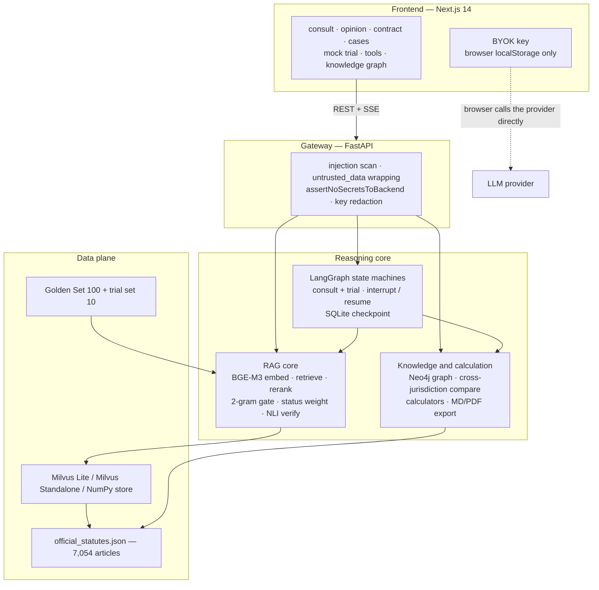

<p align="center">
  
</p>

<h1 align="center">EXCLUSLAWYER</h1>

<p align="center"><strong>An open-source, multi-jurisdiction legal reasoning workbench — every conclusion bound to the verbatim text of a currently effective statute.</strong></p>

<p align="center">
  <a href="README.md">English</a> · <a href="README.zh-CN.md">简体中文</a> · <a href="README.ja.md">日本語</a> · <a href="README.ko.md">한국어</a>
</p>

<p align="center">
  <a href="#overview">Overview</a> ·
  <a href="#features">Features</a> ·
  <a href="#core-principles">Core Principles</a> ·
  <a href="#architecture">Architecture</a> ·
  <a href="#jurisdictions--data-sources">Jurisdictions</a> ·
  <a href="#quick-start">Quick Start</a> ·
  <a href="#repository-structure">Repository</a> ·
  <a href="#documentation">Documentation</a> ·
  <a href="#status--roadmap">Roadmap</a> ·
  <a href="#known-limitations">Limitations</a> ·
  <a href="#security-privacy--compliance">Security</a> ·
  <a href="#contributing">Contributing</a> ·
  <a href="#license">License</a>
</p>

<p align="center">
  <a href="#status--roadmap"></a>
  <a href="#jurisdictions--data-sources"></a>
  <a href="#jurisdictions--data-sources"></a>
  <a href="docs/regression-report.md"></a>
  <a href="docs/regression-report.md"></a>
  <a href="docs/regression-report.md"></a>
  <a href="LICENSE"></a>
  <a href="LICENSE"></a>
</p>

<p align="center">
  
</p>

---

> **Disclaimer.** EXCLUSLAWYER is a legal information research and simulation tool. Its outputs are legal simulations for research and reference only, have no legal effect, are not legal advice, and must not be used in real litigation. The project does not provide criminal-defence strategy, litigation representation, or any other service that requires a professional licence. For matters that affect real rights and interests, consult a licensed attorney in the relevant jurisdiction.

## Overview

EXCLUSLAWYER is a legal reasoning engine, not a chat wrapper. It retrieves statute text from official public sources, binds every conclusion to the articles it actually read, stress-tests each position from the opposing counsel's point of view, discounts provisions that are no longer in force, and keeps China, Japan, Korea and Singapore comparable inside one schema.

When retrieval finds nothing that survives the quality gate, the engine answers **insufficient evidence** rather than inventing a citation. That refusal is the product's most important behaviour.

The workbench is designed for two settings: research and study on a private machine, and self-hosted deployment inside an organisation that cannot send case material to a third-party API. Model keys are optional — the retrieval and verification core runs without any LLM at all, and the answer degrades to citation-only extractive mode.

<div align="center">

| | |
| --- | --- |
| **Statutes ingested** | 7,054 from official sources |
| **Jurisdictions** | China · Japan · Korea · Singapore |
| **Backend suite** | 113 passed · 4 skipped · 0 failed |
| **Frontend suite** | 49 / 49 |
| **Hallucination rate** | 0 % on the 100-case Golden Set |
| **Deployment** | Docker Compose, or run from source |
| **Keys** | Optional — BYOK stays in the browser |

</div>

## Features

Everything listed here ships in this repository and is exercised by the test suite.

**Grounded retrieval with a hallucination gate.** Official statute text is embedded with BGE-M3 and reranked by bge-reranker-v2-m3. A candidate survives only if its character 2-gram overlap with the query reaches 0.08, or its semantic similarity reaches 0.35. Time status weights the ranking (effective 1.0 · amended 0.85 · unknown 0.7 · repealed 0.3) — repealed provisions are down-weighted and labelled, never silently deleted.

**Consult state machine.** A LangGraph workflow runs fact structuring → retrieval → adversarial dual-view → NLI verification → opinion assembly, with an interrupt before any conclusion that failed verification is published. The operator can approve or reject; a checkpoint store keeps the session resumable.

**Mock trial.** A seven-phase courtroom simulation — case intake → fact fixation → complaint filing → evidence review → adversarial debate → closing statements → simulated judgment — streamed over SSE, persisted per session, and exportable as Markdown or PDF with the complete citation trail.

**Plain-language layer.** A toggle (on by default) puts a plain-language reading of the answer above the professional analysis, with 26 built-in legal terms explained on click, each with an everyday analogy. The wording is assembled from the citations the backend actually returned — it never introduces a legal basis that was not retrieved.

**Scenario entry.** Eight everyday situations (renting and deposits, employment, consumer purchases, traffic, family, inheritance, contracts, neighbour disputes) lead into a short questionnaire whose structured summary prefills the consultation box, which stays editable.

**Cross-jurisdiction comparison and knowledge graph.** The same topic can be pulled across the four jurisdictions, with `ANALOGOUS_TO` edges linking corresponding rules. The graph runs on Neo4j when one is available and falls back to a 55-node / 64-edge snapshot otherwise, so the answer path never breaks.

**Supporting tools.** Five-section opinion writer, contract text scanner (PDF and pasted text), case search, an OCR / multimodal path, calculators for statutory economic compensation, double-wage claims and personal-injury damages, and a feedback channel that feeds the Golden Set.

**Interface details.** Light and dark themes, glassmorphism and neumorphism surfaces driven by CSS custom properties, skeleton loading, keyboard-reachable controls, `prefers-reduced-motion` support, and inline SVG icons throughout — no emoji, no icon fonts, no external assets at runtime.

## Verification & Benchmarks

| Metric | Result | Gate |
| --- | --- | --- |
| Golden Set, main set (100 cases) | **100 / 100** behaviour gates passed | all pass |
| Hallucination rate | **0 %** | ≤ 3 % |
| Citation recall | **100 %** | ≥ 98 % |
| Conclusion-evidence consistency (NLI) | **100 %** | ≥ 90 % |
| Timeliness accuracy | **100 %** | ≥ 99 % |
| Mock-trial Golden Set (10 cases) | all gates passed, four metrics within threshold | — |
| Backend suite (pytest) | **113 passed · 4 skipped · 0 failed** | 0 failed |
| Frontend suite (vitest) | **56 / 56** across 7 files | all green |
| Production build (`next build`) | **exit 0 · 0 warnings** — `/` 22.9 kB, First Load 132 kB | — |
| Lighthouse, scenario page (`/`) | perf **0.99** · a11y **1.00** · LCP **2.0 s** · CLS **0** · TBT 90 ms | LCP < 2.5 s, CLS < 0.1 |
| Lighthouse, mock trial (`/mock-trial`) | perf **1.00** · a11y **1.00** · LCP **1.9 s** · CLS **0** · TBT 50 ms | LCP < 2.5 s, CLS < 0.1 |
| Interaction latency (INP) | **N/A** — headless audits produce no interaction sample, re-test pending | < 200 ms, unverified |

The four skipped backend cases are the Neo4j live-database checks: they need a running Docker instance, while the snapshot backend covering the same path runs on every test pass. INP is reported as N/A rather than estimated, because a headless Lighthouse run records no pointer or keyboard interaction.

Methodology, thresholds and the full matrix: [docs/eval.md](docs/eval.md) · [docs/regression-report.md](docs/regression-report.md).

## Core Principles

Four rules run through the whole pipeline. They are not stylistic preferences; they are enforced in code and covered by tests.

1. **Grounded citations.** No conclusion without the verbatim text of a currently effective statute. If retrieval returns nothing that passes the quality gate, the answer is *insufficient evidence*.
2. **Adversarial dual view.** Every position is examined from the opposing counsel's perspective: factual gaps are hunted, and legal risks are raised only when a targeted retrieval actually supports them.
3. **Time-aware authority.** Status, effective date and amendment history are stored with every provision. Superseded text is down-weighted and kept for the record, never quietly removed.
4. **Comparable jurisdictions.** China, Japan and Korea share one mainland-law schema; Singapore carries a separate common-law precedent layer. Differences between them are data, not architecture.

## Architecture



### Tech Stack

| Layer | Technology | Notes |
| --- | --- | --- |
| Frontend | Next.js 14.2.5 · React 18.3 · TypeScript 5.5 · Tailwind CSS 3.4 | App Router, static export of both routes |
| Graph and icons | AntV G6 5.1 · lucide-react 0.408 | Knowledge-graph canvas; inline SVG, no emoji |
| API | FastAPI ≥ 0.110 · Pydantic ≥ 2.6 · pydantic-settings ≥ 2.2 · uvicorn ≥ 0.29 | REST plus SSE streaming |
| Orchestration | LangGraph ≥ 0.2 · langgraph-checkpoint-sqlite ≥ 2.0 | Two state machines, interrupt and resume |
| Retrieval | FlagEmbedding (BGE-M3, bge-reranker-v2-m3) · pymilvus ≥ 2.4 · NumPy fallback | Reranker degrades to vector similarity if the model host is unreachable |
| Documents | pypdf ≥ 4.0 · reportlab ≥ 4.0 | Contract scanning, statute PDF de-pollution, trial-record export |
| Infrastructure | Docker Compose · Redis 7 · Milvus 2.4.4 (etcd + MinIO) · Neo4j 5.20 · Celery worker | Minimal and full profiles |
| Testing | pytest ≥ 8.0 · vitest 2.1 · Lighthouse 12.8 · Playwright (Chromium) | 117 backend cases, 56 frontend cases, accessibility and performance gates |
| Runtime | Python ≥ 3.11 (verified on 3.13.12) · Node ≥ 18 (verified on 22.22) | Node 22 recommended for the frontend toolchain |

## Jurisdictions & Data Sources

**7,054 articles ingested, all from official public portals.** No commercial database is used or supported — Westlaw, LexisNexis, 北大法宝 and 威科先行 are deliberately out of scope, and the data pipeline contains no adapter for them.

| Jurisdiction | Articles | Official source | Notes |
| --- | --- | --- | --- |
| China | 2,338 | [flk.npc.gov.cn](https://flk.npc.gov.cn) | National laws and administrative regulations; `sxx` flag distinguishes repealed / previous / current |
| Japan | 2,610 | [laws.e-gov.go.jp](https://laws.e-gov.go.jp) | e-Gov law search, including 134 supplementary provisions (`附則`) |
| Korea | 1,856 | [law.go.kr](https://law.go.kr) | Korean Law Information Centre; the constitution is stored under its official name |
| Singapore | 250 | [sso.agc.gov.sg](https://sso.agc.gov.sg) | Singapore Statutes Online: Contracts 107, CRTPA 9, Electronic Transactions 71, Sale of Goods 63 |

China, Japan and Korea share one mainland-law schema, so a concept such as limitation periods can be queried across all three. Singapore is common law and carries a separate precedent layer, anchored to judgements rather than to code articles.

Every article keeps its jurisdiction, language, status, effective date and amendment history. Re-running the ingestion is idempotent: upserts are keyed by article id.

## Quick Start

```bash
git clone https://github.com/zyh798-cell/excluslawyer.git
cd excluslawyer
```

### Docker

```bash
# minimal stack — API + web + Redis (the vector store is a local file)
docker compose up --build

# full stack — adds Milvus Standalone, Neo4j and a Celery worker
docker compose --profile full up --build
```

- Web interface — <http://localhost:3000>
- API documentation — <http://localhost:8000/docs>

### From source

```bash
cd backend
python -m venv .venv
source .venv/bin/activate          # Windows: .venv\Scripts\activate
pip install -r requirements.txt     # core runtime, no torch
pip install -r requirements-ml.txt  # optional: BGE-M3 embeddings and reranker
python scripts/ingest_cn.py         # seed the vector store
uvicorn app.main:app --reload --port 8000

cd ../frontend
npm install
npm run dev
```

Without `requirements-ml.txt` the engine still runs end to end: embeddings fall back to hashing vectors and the language model enters citation-only demo mode. Degraded, yes — but never hallucinating.

To refresh the statute corpus from the official portals instead of the bundled seed:

```bash
cd backend
python scripts/fetch_statutes.py --jur --ingest      # empty --jur: merge and index offline, no network
python scripts/build_kg.py                            # rebuild the knowledge-graph snapshot
```

### BYOK — bring your own key

Model access is optional and the key never reaches the server.

1. Open the web interface and expand **BYOK 设置** in the header.
2. Paste an OpenAI-compatible endpoint, API key and model name.
3. The key is written to the browser's `localStorage` under `excluslawyer.byok` and stays there.

The browser calls your model provider directly. The backend exposes only stateless retrieval (`/api/retrieve`) and verification (`/api/verify`); every payload sent to it is asserted free of secrets, and the server refuses to hold a key at all. Without a key, answers fall back to extractive mode — statute excerpts only, with no free-text generation.

For server-side demo mode, copy `.env.example` to `.env` and set `LLM_BASE_URL`, `LLM_API_KEY` and `LLM_MODEL`. Leave them empty for BYOK deployments.

## Repository Structure

```text
excluslawyer/
├── backend/
│   ├── app/
│   │   ├── api/             # REST and SSE routes
│   │   ├── core/            # LLM client · prompts · security guards
│   │   ├── data_pipeline/   # official-source fetchers and normalisers
│   │   ├── eval/            # Golden Set runners
│   │   ├── graph/           # LangGraph consult and trial state machines
│   │   ├── kg/              # schema · builder · Neo4j backend · snapshot
│   │   ├── rag/             # embedder · retriever · vector stores
│   │   ├── services/        # ask · opinion · trial · compare · export
│   │   └── main.py
│   ├── data/                # statutes · golden sets · KG snapshot (partly git-ignored)
│   ├── scripts/             # fetch_statutes · ingest_cn · build_kg · golden_regression
│   └── tests/               # 117 collected cases — 113 passed · 4 skipped
├── frontend/
│   ├── src/app/             # routes: / and /mock-trial
│   ├── src/components/      # UI components
│   ├── src/config/          # scenario definitions
│   ├── src/lib/             # API client · theme · plain-language engine · term glossary
│   └── src/test/            # vitest suites — 56 cases
├── assets/                  # brand vector source (logo.svg)
├── tools/                  # brand-asset builder and README consistency checker
├── docs/                    # documentation set and brand assets
├── docker-compose.yml
├── .env.example
└── LICENSE
```

## Documentation

| Document | Contents |
| --- | --- |
| [docs/architecture.md](docs/architecture.md) | Dual-backend retrieval, BGE-M3 pipeline, knowledge graph, official-source ingestion, SGA 1979 PDF de-pollution |
| [docs/scenario-entry.md](docs/scenario-entry.md) | Scenario entry layer: eight life scenarios, stepwise questionnaire, structured summary prefill, accessibility work |
| [docs/plain-explain.md](docs/plain-explain.md) | Plain-language layer: mode toggle, generation rules, section layout, 26-term glossary |
| [docs/mock-court.md](docs/mock-court.md) | Mock-court state machine, seven trial phases, evidence and limitation mechanisms, MD and PDF export |
| [docs/mock-trial.md](docs/mock-trial.md) | Implementation notes: checkpointer serialisation, SSE framing, export schema |
| [docs/eval.md](docs/eval.md) | Golden Set methodology, hallucination verification, regression matrix |
| [docs/regression-report.md](docs/regression-report.md) | Regression report of the current iteration: test counts, build output, Lighthouse results, manual verification matrix |
| [docs/known-issues.md](docs/known-issues.md) | Known-issue list: symptom, root cause, impact, remediation plan, status per item |

Brand assets live alongside the documents: [docs/banner.svg](docs/banner.svg) (animated banner), [docs/logo.svg](docs/logo.svg) (120 × 120 animated mark), [docs/favicon.svg](docs/favicon.svg) (monochrome silhouette for 16 / 24 / 32 px) and [assets/logo.svg](assets/logo.svg) (static vector master). Each file is self-contained SVG with inline CSS animation and no external dependency; motion is disabled under `prefers-reduced-motion: reduce`.

## Status & Roadmap

**v0.1.0 is a pre-release.** The engine, the mock court, the plain-language layer and the data pipeline are working and tested. The interface is available in Simplified Chinese only.

### In progress

- Structured questionnaire schema with server-side validation (the questionnaire currently validates in the browser only)
- Procedural guidance — a "what to do next" action list, linked to official filing channels and limitation periods
- Multi-language interface — the documentation exists in four languages; the product interface does not
- Individualised plain-language generation — the backend may return a `plain_answer` field that the frontend will prefer over the deterministic template
- Evidence assistant, document template generation, cross-border topic packs
- Multilingual term glossary beyond the 26 Chinese-language terms

### Planned

- Public evaluation dashboard
- De-identified demo case library
- Browser extension
- Mobile PWA
- Additional jurisdictions

## Known Limitations

- **Consistency checking is lexical, not semantic.** The NLI stage approximates "conclusion matches evidence" with character and word overlap. It is deliberately conservative — a mismatch degrades the answer instead of passing it — but a correct rephrasing can be scored low.
- **Interaction latency is unmeasured.** Lighthouse runs headless and produces no interaction trace, so INP is reported as N/A rather than guessed. LCP and CLS are within budget on both routes.
- **Graph tests need Docker.** Four Neo4j cases are skipped when no Neo4j instance is reachable; the snapshot backend is covered instead.
- **Two trial APIs coexist.** The older round-based endpoints remain for compatibility and are marked for removal; the interface already uses the state machine.
- **The Singapore portal is rate-sensitive.** Its WAF intermittently rejects automated requests; the pipeline waits out the cooldown and back-fills incrementally rather than retrying blindly.
- **Cross-jurisdiction seed entries need verification.** Some topic-level comparison rows are summary seeds and are labelled as requiring official confirmation.
- **The plain-language layer is templated.** It translates and explains; it does not call a language model, so it cannot be more specific than the citations it was given.
- **The interface language is Simplified Chinese only.** Documentation is multilingual; the product is not yet.

## Security, Privacy & Compliance

- **Case data stays local.** Documents and case material are parsed on the machine that runs the engine. Nothing is uploaded to a third-party service unless you configure it yourself, and nothing is used for model training.
- **Documents are not persisted unless you ask.** Parsed text is held for the current session; an explicit action is required to save it.
- **Prompt injection is contained.** Retrieved documents and user text are wrapped as untrusted data and kept physically apart from system prompts; jailbreak templates are detected and refused.
- **Keys never reach the server.** BYOK keys live in browser `localStorage`, the browser calls the provider directly, payloads sent to the backend are asserted free of secrets, and error output is redacted.
- **Official public sources only.** Statute text comes from public legal portals; court documents are privacy-scrubbed before ingestion. No commercial database is connected.
- **Refusal by design.** Criminal-defence strategy, litigation representation and other licensed-practice deliverables are refused and redirected to a licensed attorney.
- **This repository ships code only.** Operators who deploy a public instance take on their own legal, privacy and security obligations; the project provides no warranty and no hosting.

## Contributing

Issues and pull requests are welcome, especially where they tighten a citation, improve a failing retrieval case or extend coverage to another jurisdiction.

- Run the backend suite before submitting: `cd backend && python -m pytest tests/ -q`
- Run the frontend suite: `cd frontend && npm test`
- Keep the four core principles intact — changes that weaken grounding, adversarial review, time awareness or jurisdiction comparability will not be merged.
- New jurisdiction support must use official public sources and document the ingestion method, the quality gate and the tests.
- Match the existing code style and keep user-facing copy free of emoji — icons are inline SVG.

## License

- **Code** — [AGPL-3.0](LICENSE). The engine source is licensed under the GNU Affero General Public License v3.
- **Dataset** — statute texts and knowledge-graph snapshots are released under [CC BY-NC 4.0](https://creativecommons.org/licenses/by-nc/4.0/). The statute wording comes from the official public legal databases (flk.npc.gov.cn, laws.e-gov.go.jp, law.go.kr, sso.agc.gov.sg); the structuring, cleanup and graph construction are original work, reusable non-commercially with attribution.

---

<p align="center"><em>Intelligence · Precision · Open by design</em></p>
