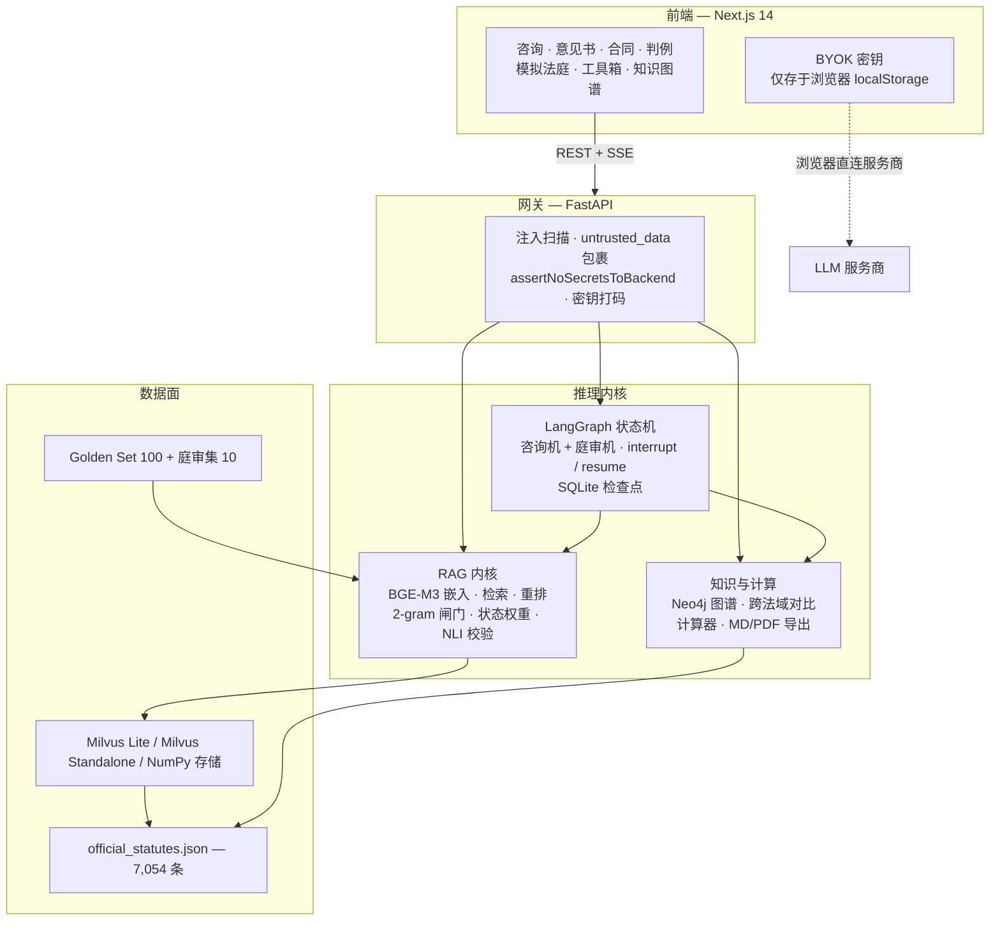

<p align="center">
  
</p>

<h1 align="center">EXCLUSLAWYER</h1>

<p align="center"><strong>开源的多法域法律推理工作台——每一个结论都绑定现行法条的原文。</strong></p>

<p align="center">
  <a href="README.md">English</a> · <a href="README.zh-CN.md">简体中文</a> · <a href="README.ja.md">日本語</a> · <a href="README.ko.md">한국어</a>
</p>

<p align="center">
  <a href="#概览">概览</a> ·
  <a href="#功能特性">功能特性</a> ·
  <a href="#核心原则">核心原则</a> ·
  <a href="#系统架构">系统架构</a> ·
  <a href="#法域与数据源">法域</a> ·
  <a href="#快速开始">快速开始</a> ·
  <a href="#仓库结构">仓库</a> ·
  <a href="#文档">文档</a> ·
  <a href="#状态与路线图">路线图</a> ·
  <a href="#已知限制">限制</a> ·
  <a href="#安全隐私与合规">安全</a> ·
  <a href="#参与贡献">贡献</a> ·
  <a href="#许可证">许可证</a>
</p>

<p align="center">
  <a href="#状态与路线图"></a>
  <a href="#法域与数据源"></a>
  <a href="#法域与数据源"></a>
  <a href="docs/regression-report.md"></a>
  <a href="docs/regression-report.md"></a>
  <a href="docs/regression-report.md"></a>
  <a href="LICENSE"></a>
  <a href="LICENSE"></a>
</p>

<p align="center">
  
</p>

---

> **免责声明。** EXCLUSLAWYER 是法律信息研究与推演工具。其输出仅为研究参考性质的法律推演，不具法律效力，不构成法律意见，不可用于真实诉讼。本项目不提供刑事辩护策略、诉讼代理等需要执业资质的服务。对于影响真实权利与利益的重大事项，请咨询对应法域的持证律师。

## 概览

EXCLUSLAYWER 是一套法律推理引擎，而不是一个聊天壳。它从官方公开源检索法条原文，把每一个结论绑定到它真正读过的条文，从对方律师视角反复拷问每一个立场，对已失效的条文降权，并把中国、日本、韩国、新加坡放进同一套 schema 里横向比较。

当检索没有产出能通过质量闸门的结果时，引擎回答**证据不足**，而不是编造一条法条。这种"拒绝"才是本项目最重要的行为。

本工作台面向两类场景：在私有设备上做研究与学习，以及在不能把案件材料交给第三方 API 的机构内部自建部署。模型密钥是可选的——检索与校验内核在完全没有 LLM 的情况下也能运行，答案会降级为"只给法条摘录"模式。

<div align="center">

| | |
| --- | --- |
| **入库法条** | 7,054 条，全部来自官方源 |
| **法域** | 中国 · 日本 · 韩国 · 新加坡 |
| **后端测试** | 113 passed · 4 skipped · 0 failed |
| **前端测试** | 49 / 49 |
| **幻觉率** | 100 条 Golden Set 上为 0 % |
| **部署方式** | Docker Compose，或源码运行 |
| **密钥** | 可选——BYOK 只留在浏览器 |

</div>

## 功能特性

以下条目均已在本仓库中实现，并有测试覆盖。

**带幻觉闸门的溯源检索。** 官方法条以 BGE-M3 嵌入、bge-reranker-v2-m3 重排。候选条文必须与查询达到 0.08 的字符 2-gram 重叠率，或语义相似度达到 0.35，才会被召回。时效状态参与排序加权（现行 1.0 · 已修订 0.85 · 时效不明 0.7 · 已废止 0.3）——废止条文被降权并标注，绝不静默删除。

**咨询状态机。** LangGraph 工作流依次执行事实结构化 → 检索 → 双视角对抗 → NLI 校验 → 意见组装；任何未通过校验的结论在发布前都会中断等待人工裁决。操作员可批准或驳回，检查点存储保证会话可恢复。

**模拟法庭。** 七阶段庭审模拟——案情受理 → 事实固定 → 起诉立案 → 证据审查 → 对抗辩论 → 辩论终结 → 模拟宣判——以 SSE 流式推送，按会话持久化，可导出带完整引用链的 Markdown 或 PDF。

**大白话解释层。** 开关（默认开启）把答案的大白话解读放在专业分析之上，内置 26 个法律术语，点击即释义并附一句日常类比。措辞完全由后端实际返回的引用组装而成——绝不引入未被检索到的法律依据。

**场景化入口。** 八种生活场景（租房押金、劳动关系、消费维权、交通、家庭、继承、合同、邻里纠纷）进入短问卷，问卷的结构化摘要会预填咨询框，且保持可编辑。

**跨法域对比与知识图谱。** 同一主题可以横跨四个法域拉取，`ANALOGOUS_TO` 边连接对应规则。图谱有 Neo4j 时走 Neo4j，没有时回退到 55 节点 / 64 边的快照，问答链路不中断。

**配套工具。** 五段式意见书、合同文本扫描（PDF 与粘贴文本）、判例检索、OCR / 多模态通路，以及法定经济补偿、二倍工资、人身损害赔偿三类计算器，还有一个把用户反馈回流到 Golden Set 的通道。

**界面细节。** 亮暗双主题、玻璃拟态与新拟态表面（由 CSS 自定义属性驱动）、骨架屏、键盘可达控件、`prefers-reduced-motion` 支持，图标全部内联 SVG——无 emoji、无图标字体、运行时无外部资源。

## 验收与基准

| 指标 | 结果 | 门槛 |
| --- | --- | --- |
| Golden Set 主集（100 条） | **100 / 100** 行为闸门全过 | 全通过 |
| 幻觉率 | **0 %** | ≤ 3 % |
| 法条引用召回率 | **100 %** | ≥ 98 % |
| 结论—依据一致性（NLI） | **100 %** | ≥ 90 % |
| 时效判定准确率 | **100 %** | ≥ 99 % |
| 庭审 Golden Set（10 例） | 行为闸门全过，四项指标在阈值内 | — |
| 后端测试（pytest） | **113 passed · 4 skipped · 0 failed** | 0 failed |
| 前端测试（vitest） | **49 / 49**，分布在 6 个测试文件 | 全绿 |
| 生产构建（`next build`） | **exit 0 · 0 警告**——`/` 22.9 kB，First Load 131 kB | — |
| Lighthouse，场景页（`/`） | perf **0.99** · a11y **1.00** · LCP **2.0 s** · CLS **0** · TBT 90 ms | LCP < 2.5 s，CLS < 0.1 |
| Lighthouse，模拟法庭（`/mock-trial`） | perf **1.00** · a11y **1.00** · LCP **1.9 s** · CLS **0** · TBT 50 ms | LCP < 2.5 s，CLS < 0.1 |
| 交互延迟（INP） | **N/A**——无头审计不产生交互样本，待复测 | < 200 ms，未验证 |

后端跳过的 4 例是 Neo4j 真库校验：需要运行中的 Docker 实例，而覆盖同一路径的快照后端每次测试都会跑。INP 标注为 N/A 而不是猜测值，因为无头 Lighthouse 运行不记录指针或键盘交互。

方法论、阈值与完整矩阵见 [docs/eval.md](docs/eval.md) · [docs/regression-report.md](docs/regression-report.md)。

## 核心原则

四条规则贯穿整条链路。它们不是风格偏好，而是写进代码并有测试覆盖的硬约束。

1. **结论必挂现行法条原文。** 没有法条原文支撑的结论一律不输出。检索没有产出能通过质量闸门的结果时，答案就是*证据不足*。
2. **双视角对抗。** 每个立场都要从对方律师的视角审视：主动寻找事实漏洞，而法律风险只有在定向检索确实命中支撑时才被提出。
3. **时效感知。** 每一条文都连同状态、生效日期与修订沿革一起入库。已被取代的条文降权保留以备查考，绝不悄悄删除。
4. **多法域可比。** 中国、日本、韩国共用一套大陆法系 schema；新加坡是普通法系，另设判例层。法域之间的差异是数据问题，不是架构问题。

## 系统架构



### 技术栈

| 层次 | 技术 | 说明 |
| --- | --- | --- |
| 前端 | Next.js 14.2.5 · React 18.3 · TypeScript 5.5 · Tailwind CSS 3.4 | App Router，两条路由均为静态导出 |
| 图谱与图标 | AntV G6 5.1 · lucide-react 0.408 | 知识图谱画布；内联 SVG，不用 emoji |
| API | FastAPI ≥ 0.110 · Pydantic ≥ 2.6 · pydantic-settings ≥ 2.2 · uvicorn ≥ 0.29 | REST 加 SSE 流式 |
| 编排 | LangGraph ≥ 0.2 · langgraph-checkpoint-sqlite ≥ 2.0 | 两台状态机，支持中断与恢复 |
| 检索 | FlagEmbedding（BGE-M3、bge-reranker-v2-m3）· pymilvus ≥ 2.4 · NumPy 兜底 | 模型源不可达时重排自动退回向量相似度排序 |
| 文档 | pypdf ≥ 4.0 · reportlab ≥ 4.0 | 合同扫描、法条 PDF 清洗、庭审记录导出 |
| 基础设施 | Docker Compose · Redis 7 · Milvus 2.4.4（etcd + MinIO）· Neo4j 5.20 · Celery worker | 最小与完整两档 profile |
| 测试 | pytest ≥ 8.0 · vitest 2.1 · Lighthouse 12.8 · Playwright（Chromium） | 后端 117 例、前端 49 例，含可访问性与性能闸门 |
| 运行时 | Python ≥ 3.11（实测 3.13.12）· Node ≥ 18（实测 22.22） | 前端工具链建议 Node 22 |

## 法域与数据源

**入库 7,054 条，全部取自官方公开门户。** 不使用也不支持任何商业数据库——Westlaw、LexisNexis、北大法宝、威科先行被明确排除在范围之外，数据管道里也没有对应的适配器。

| 法域 | 条数 | 官方来源 | 备注 |
| --- | --- | --- | --- |
| 中国 | 2,338 | [flk.npc.gov.cn](https://flk.npc.gov.cn) | 国家法律与行政法规；`sxx` 标志区分废止 / 旧版 / 现行 |
| 日本 | 2,610 | [laws.e-gov.go.jp](https://laws.e-gov.go.jp) | e-Gov 法令検索，含 134 条附則（`附則`） |
| 韩国 | 1,856 | [law.go.kr](https://law.go.kr) | 韩国法令信息中心；宪法以官方名称入库 |
| 新加坡 | 250 | [sso.agc.gov.sg](https://sso.agc.gov.sg) | Singapore Statutes Online：Contracts 107、CRTPA 9、Electronic Transactions 71、Sale of Goods 63 |

中国、日本、韩国共用一套大陆法系 schema，因此"诉讼时效"这类概念可以一次跨三地查询。新加坡属普通法系，另设判例层，以判决而非法条作为锚点。

每一条文都保留法域、语种、状态、生效日期与修订沿革。重复入库是幂等的：upsert 以条文 id 为键。

## 快速开始

```bash
git clone https://github.com/zyh798-cell/excluslawyer.git
cd excluslawyer
```

### Docker

```bash
# 最小栈 — API + Web + Redis（向量库为本地文件）
docker compose up --build

# 完整栈 — 追加 Milvus Standalone、Neo4j 与 Celery worker
docker compose --profile full up --build
```

- Web 界面 — <http://localhost:3000>
- API 文档 — <http://localhost:8000/docs>

### 源码运行

```bash
cd backend
python -m venv .venv
source .venv/bin/activate          # Windows: .venv\Scripts\activate
pip install -r requirements.txt     # 核心运行时，不含 torch
pip install -r requirements-ml.txt  # 可选：BGE-M3 嵌入与重排
python scripts/ingest_cn.py         # 灌入向量库种子
uvicorn app.main:app --reload --port 8000

cd ../frontend
npm install
npm run dev
```

不装 `requirements-ml.txt` 引擎依然能端到端跑通：嵌入退回哈希向量，语言模型进入"只给法条摘录"的演示模式。确实降级，但绝不编造。

若要从官方门户刷新法条库而不是使用内置种子：

```bash
cd backend
python scripts/fetch_statutes.py --jur --ingest      # 空 --jur：不联网，只重建合并并灌库
python scripts/build_kg.py                            # 重建知识图谱快照
```

### BYOK ——自带密钥

模型访问是可选的，密钥永不到达服务端。

1. 打开 Web 界面，展开页头的 **BYOK 设置**。
2. 填入 OpenAI 兼容端点、API Key 与模型名。
3. 密钥写入浏览器的 `localStorage`（键名 `lexsentinel.byok`）并留在那里。

浏览器直接调用你选定的模型服务商。后端只暴露无状态的检索（`/api/retrieve`）与校验（`/api/verify`）接口；发往后端的每个载荷都断言不含密钥，服务端在设计上就不持有密钥。没有密钥时，答案退回摘录模式——只给法条原文，不生成自由文本。

若使用服务端演示模式，把 `.env.example` 复制为 `.env`，设置 `LLM_BASE_URL`、`LLM_API_KEY`、`LLM_MODEL`；BYOK 部署保持它们为空。

## 仓库结构

```text
lex-sentinel/
├── backend/
│   ├── app/
│   │   ├── api/             # REST 与 SSE 路由
│   │   ├── core/            # LLM 客户端 · 提示词 · 安全守卫
│   │   ├── data_pipeline/   # 官源抓取器与归一化
│   │   ├── eval/            # Golden Set 运行器
│   │   ├── graph/           # LangGraph 咨询机与庭审机
│   │   ├── kg/              # schema · 构建器 · Neo4j 后端 · 快照
│   │   ├── rag/             # 嵌入器 · 检索器 · 向量存储
│   │   ├── services/        # ask · opinion · trial · compare · 导出
│   │   └── main.py
│   ├── data/                # 法条 · Golden Set · 图谱快照（部分被 git 忽略）
│   ├── scripts/             # fetch_statutes · ingest_cn · build_kg · golden_regression
│   └── tests/               # 收集 117 例 — 113 passed · 4 skipped
├── frontend/
│   ├── src/app/             # 路由：/ 与 /mock-trial
│   ├── src/components/      # UI 组件
│   ├── src/config/          # 场景配置
│   ├── src/lib/             # API 客户端 · 主题 · 白话引擎 · 术语表
│   └── src/test/            # vitest 用例 — 49 例
├── assets/                  # 品牌矢量源文件（logo.svg）
├── tools/                  # 品牌资产构建器与 README 一致性校验脚本
├── docs/                    # 文档集与品牌资源
├── docker-compose.yml
├── .env.example
└── LICENSE
```

## 文档

| 文档 | 内容 |
| --- | --- |
| [docs/architecture.md](docs/architecture.md) | 双后端检索、BGE-M3 流水线、知识图谱、官源数据管道、SGA 1979 PDF 清洗 |
| [docs/scenario-entry.md](docs/scenario-entry.md) | 场景化入口层：八种生活场景、分步问卷、结构化摘要预填、可访问性整改记录 |
| [docs/plain-explain.md](docs/plain-explain.md) | 大白话解释层：模式开关、生成规则、分区布局、26 条术语释义 |
| [docs/mock-court.md](docs/mock-court.md) | 模拟法庭状态机、七个庭审阶段、证据与时效机制、MD 与 PDF 导出 |
| [docs/mock-trial.md](docs/mock-trial.md) | 实现笔记：检查点序列化、SSE 分帧、导出 schema |
| [docs/eval.md](docs/eval.md) | Golden Set 方法论、幻觉率验证、回归矩阵 |
| [docs/regression-report.md](docs/regression-report.md) | 本轮回归报告：测试数、构建产物、Lighthouse 结果、人工核对矩阵 |
| [docs/known-issues.md](docs/known-issues.md) | 遗留缺陷清单：现象、根因、影响、修复计划与逐项状态 |

品牌资源与文档同目录：`docs/banner.svg`（动态横幅）、`docs/logo.svg`（120 × 120 动态标识）、`docs/favicon.svg`（16 / 24 / 32 px 单色剪影）与 `assets/logo.svg`（静态矢量母版）。每个文件都是自包含 SVG，动效以内联 CSS 实现，无任何外部依赖；在 `prefers-reduced-motion: reduce` 下动效自动关闭。

## 状态与路线图

**v0.1.0 是预发布版本。** 引擎、模拟法庭、大白话解释层与数据管道均已可用并通过测试。界面目前仅有简体中文。

### 进行中

- 问卷结构化 schema 与服务端校验（当前问卷只在浏览器端校验）
- 程序指引——"下一步该做什么"的行动清单，与官方立案渠道与诉讼时效联动
- 多语言界面——文档已有四语，产品界面尚未提供
- 白话个性化生成——后端若产出 `plain_answer` 字段，前端将优先取用而非使用确定性模板
- 证据助手、文书模板生成、跨境专题包
- 26 条中文术语之外的多语术语对照

### 规划中

- 公开评测看板
- 脱敏 Demo 案例库
- 浏览器插件
- 移动端 PWA
- 新增法域

## 已知限制

- **一致性校验是词面而非语义。** NLI 环节用字符与词的集合重叠近似"结论是否与依据相符"。它的取向是保守的——对不上就降级而不是放行——但表述正确却用词不同的结论可能被低估。
- **交互延迟尚未测量。** Lighthouse 无头运行不产生交互 trace，因此 INP 标注为 N/A 而不是猜测值。两条路由的 LCP 与 CLS 均在预算内。
- **图谱测试需要 Docker。** 没有可连的 Neo4j 实例时，4 个用例被跳过；相应的快照后端已有覆盖。
- **两套庭审 API 并存。** 旧的轮次制接口为兼容保留并已标记待移除；界面已改用状态机。
- **新加坡门户对频率敏感。** 其 WAF 会间歇性拒绝自动请求，管道做法是等冷却后增量补齐，而不是盲目重试。
- **跨法域种子条目需要复核。** 部分主题级对比行是概要种子，已标注"需官源核对"。
- **大白话层是模板化的。** 它只做翻译与解释，不调用语言模型，因此不会比它拿到的引用更具体。
- **界面语言只有简体中文。** 文档是多语的，产品还不是。

## 安全、隐私与合规

- **案件数据留在本地。** 文书与案件材料由运行引擎的这台机器解析。除非你自己配置，否则不会上传到第三方服务，也不会被用于模型训练。
- **文书默认不落盘。** 解析出的文本只在当前会话内保留，需要显式操作才会保存。
- **提示词注入被物理隔离。** 检索到的文书与用户文本一律以不可信数据包裹，与系统提示词分开存放；越狱模板会被识别并拒答。
- **密钥永不到达服务端。** BYOK 密钥存放在浏览器 `localStorage`，由浏览器直连服务商，发往后端的载荷断言不含密钥，报错输出打码。
- **只用官方公开源。** 法条文本来自公开法律门户；法院文书入库前做隐私脱敏。不接任何商业数据库。
- **按设计拒绝。** 刑事辩护策略、诉讼代理等需要执业资质的产出一律拒绝，并引导至持证律师。
- **本仓库只提供代码。** 部署公开实例的运营者自行承担法律、隐私与安全责任；项目不提供任何担保，也不提供托管。

## 参与贡献

欢迎提交 issue 与 pull request，尤其是能收紧引用、改善失败检索案例或把覆盖扩展到新法域的改动。

- 提交前跑通后端测试：`cd backend && python -m pytest tests/ -q`
- 跑通前端测试：`cd frontend && npm test`
- 保持四条核心原则不变——削弱溯源、对抗、时效或法域可比性的改动不会被合入。
- 新增法域必须使用官方公开源，并写明抓取方式、质量闸门与测试。
- 遵循既有代码风格，面向用户的文案不得使用 emoji——图标一律内联 SVG。

## 许可证

- **代码** — [AGPL-3.0](LICENSE)。引擎源码以 GNU Affero General Public License v3 授权。
- **数据集** — 法条文本与知识图谱快照以 [CC BY-NC 4.0](https://creativecommons.org/licenses/by-nc/4.0/) 发布。法条表述来自官方公开法律数据库（flk.npc.gov.cn、laws.e-gov.go.jp、law.go.kr、sso.agc.gov.sg）；结构化、清洗与图谱构建属原创工作，署名后可非商业复用。

---

<p align="center"><em>Intelligence · Precision · Open by design</em></p>
